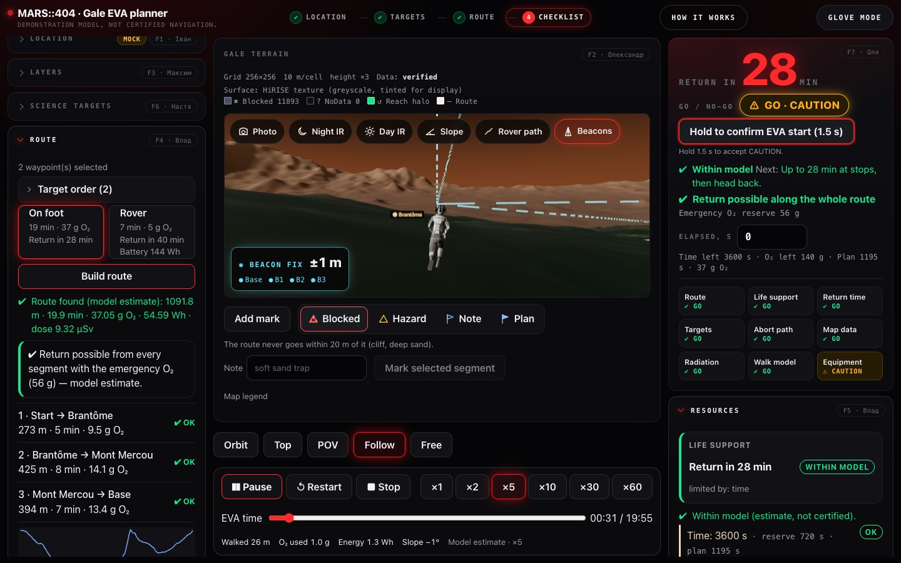
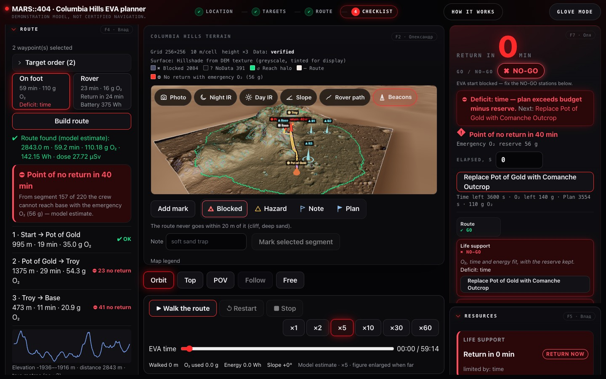

# MARS//404 — know when to turn back

A forearm-tablet planner for a Marswalk that tells the astronaut when to turn back, built on real NASA terrain.

**[Live app](https://xand0dev.github.io/mars404/)** (no login) · **Demo video:** _TODO (Oleksandr)_ · **Slides:** _TODO_ · **Code:** Apache-2.0

NASA Space Apps Challenge 2026 · Challenge: **Interplanetary Survival Guide: Martian Map**

| Gale: route built, **Return in 28 min**, GO · CAUTION | Walk the route: beacon lines, **Beacon fix ±1 m** | Columbia Hills: **NO-GO**, point of no return |
|---|---|---|
|  |  |  |

Screenshots from the live app, 1440 × 900.

## What it does

- **Route on real HiRISE terrain.** Pick science targets at real Curiosity and Spirit stops; the app builds a walking loop base → targets → base that avoids steep, blocked and no-data ground, with an elevation profile.
- **Return in N min.** One countdown from oxygen, energy and time with a fixed reserve, plus the reachable area on the map.
- **Point of no return.** Segments with no safe way back turn red; the emergency O₂ for the walk home is never spent.
- **GO / NO-GO.** A checklist before the walk (route, life support, return time, targets, abort path, map data, radiation, walk model, equipment). When the plan fails, the app suggests a closer target.
- **Navigation without GPS.** Beacons placed by line of sight plus inertial position with drift; the app shows how much of the route has a precise position.
- **Walk the route.** An astronaut walks the plan over the terrain (Follow camera, 1×–60×) with elapsed time, O₂ and energy; a Rover mode compares the same plan by rover.
- **Map layers.** Photo (HiRISE), Night IR and Day IR (THEMIS), Slope, Rover path and Beacons; each layer shows its source.
- **Crew map notes.** Blocked / Hazard / Note / Plan marks that reroute the plan. Glove mode, keyboard, 400 px phone layout.

Sites on the 3D globe: Gale crater / Mount Sharp and Columbia Hills (walking sites), Olympus Mons and Valles Marineris (terrain only).

## NASA data

HiRISE 1 m elevation models of Gale crater and the Columbia Hills and the HiRISE orthomosaic of the Curiosity area (NASA Mars Trek), THEMIS day and night infrared (Mars Odyssey), the MOLA + HRSC 200 m elevation model, the Viking MDIM 2.1 colour mosaic, Curiosity and Spirit traverses, and rover surface photos (NASA/JPL-Caltech).

HRSC data: **ESA/DLR/FU Berlin, CC BY-SA 3.0 IGO**. Full list with product IDs, dates, licences and credits: [`docs/SOURCES.md`](docs/SOURCES.md).

## How it works

```text
NASA Mars Trek, MMGIS, rover images
        │  once, offline
        ▼
pipeline/  (Python + GDAL)  crop → resample → slope / hazard → validate
        ▼
public/data/<site>/  static data packages
        ▼
React 19 + TypeScript + Three.js  (route, return model, HUD)
        ▼
GitHub Pages: a static site, works offline, no API calls, no keys
```

## Run locally

Node.js 22.22+, 24.15+ or 26+ (CI uses Node 24, see `.nvmrc`).

```bash
npm ci
npm run dev      # development server
npm run check    # lint + typecheck + unit tests + build
npm run e2e      # Playwright end-to-end tests (Chrome)
```

All data is already in `public/data/`; to rebuild it from NASA sources see [`pipeline/README.md`](pipeline/README.md).

## Honest model

MARS//404 is a demonstration, not certified navigation. The best status it ever shows is "within model", never "safe". Every model number in the app shows its source or the label **assumption**; NoData ground is always blocked. Full list of assumptions: [`specs/F5/assumptions-en.md`](specs/F5/assumptions-en.md).

## Team

| Name | GitHub | Role |
|---|---|---|
| Oleksandr | [@xand0dev](https://github.com/xand0dev) | integration, 3D terrain |
| Olia | [@oljyaaa](https://github.com/oljyaaa) | UI, HUD, pitch |
| Ivan | [@gonivanko](https://github.com/gonivanko) | 3D globe |
| Maksym | [@kingsneverdie17](https://github.com/kingsneverdie17) | NASA data pipeline |
| Vlad | [@froozy3](https://github.com/froozy3) | route & return model |
| Nastia | [@Bulka0801](https://github.com/Bulka0801) | science targets, QA |

**Use of AI.** Code, tests and docs were written with AI coding agents from specifications written by people; people reviewed every change in the browser and on CI and decided what to merge. Every session is logged in [`docs/AI_LOG.md`](docs/AI_LOG.md). No AI-generated data or numbers are presented as NASA data.

---

## For contributors

1. `docs/SPEC.md` — продукт, контракти, формули, фічі F0–F8 з власниками й AC.
2. `CONSTITUTION.md`, `AGENTS.md` — правила роботи (для людей і агентів).
3. `specs/F<N>/spec.md` — твоя фіча.

Licence: Apache-2.0.
