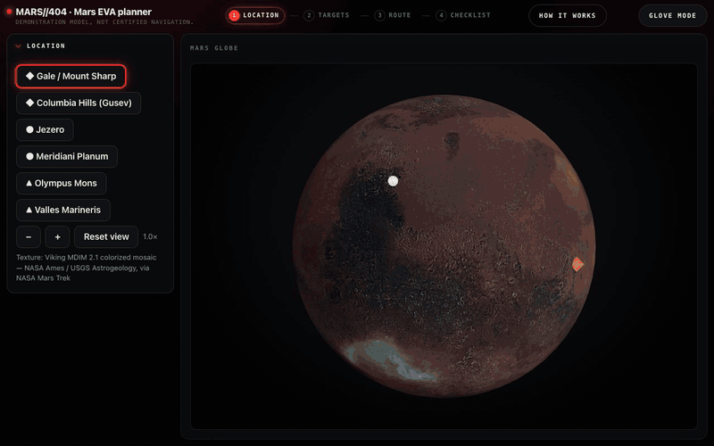
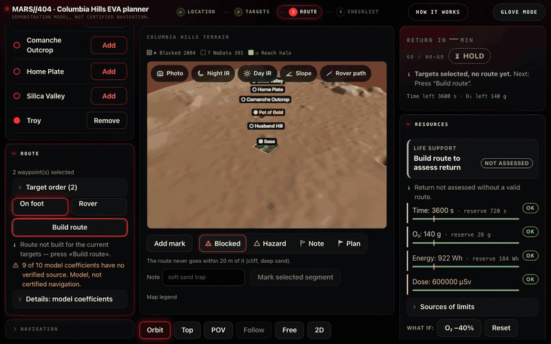
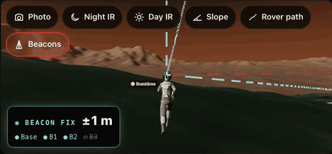
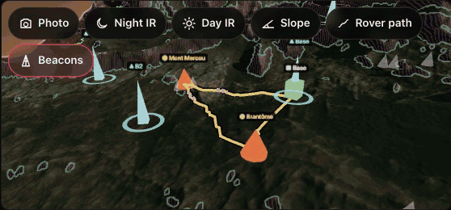
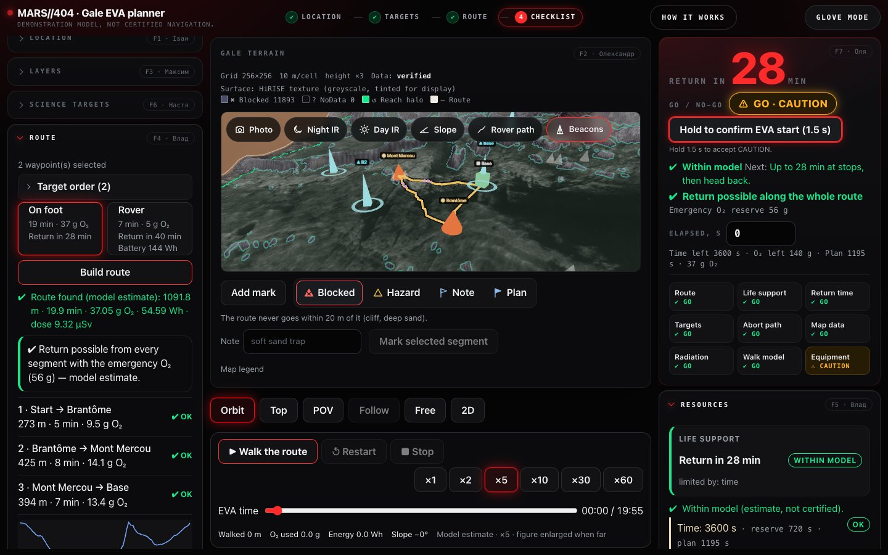
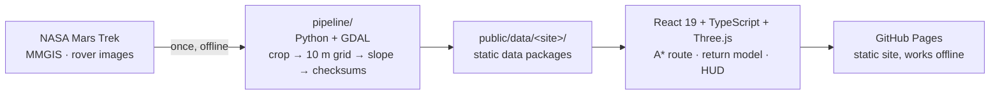

<div align="center">

# MARS//404

### know when to turn back

A forearm-tablet planner for an astronaut on a Marswalk: where to go for science, how to get there safely,<br>and the exact minute to turn back — on real NASA terrain.

**[▶ Open the live app](https://xand0dev.github.io/mars404/)** &nbsp;·&nbsp; [Slides](docs/demo/MARS404_slides.pdf) &nbsp;·&nbsp; [Data sources](docs/SOURCES.md) &nbsp;·&nbsp; [AI log](docs/AI_LOG.md)

    



*Globe → Gale crater → two science targets → **Build route** → “Return in 28 min”. Recorded on the live app.*

</div>

NASA Space Apps Challenge 2026 · Challenge: **Interplanetary Survival Guide: Martian Map**

## The problem

On Mars there is no GPS and no second chance. A radio signal to Earth takes minutes one way, so mission control cannot answer in time. An astronaut walking to a science target must know, at every moment, one thing:

> **How far can I go and still make it back?**

Oxygen, energy and time are one budget, spent twice — out and back. And the way back is not the way out: slopes and soft sand change the time.

## See it in action

| When the plan is wrong, it says so — and offers a fix | Navigation without GPS |
|---|---|
|  |  |
| Columbia Hills: Pot of Gold + Troy is too far → **NO-GO**, point of no return in 40 min. One tap: *Replace Pot of Gold with Comanche Outcrop*. | Radio beacons with line of sight to the route. Three or more in view → **Beacon fix ±1 m**; fewer → *Inertial ±N m* until the next checkpoint. |

| Map layers that do real work | The whole screen at a glance |
|---|---|
|  |  |
| HiRISE photo, THEMIS night and day infrared, slope, rover path. Night IR: dark = loose sand = slower walk. Slope over 25° is never walkable. | “Return in N min” is the biggest number on screen. Nine GO / NO-GO stations sit under it. |

## Try it in 30 seconds

1. Open **[xand0dev.github.io/mars404](https://xand0dev.github.io/mars404/)** — no login, no install.
2. Choose **Gale / Mount Sharp** on the globe.
3. Add **Brantôme** and **Mont Mercou**, press **Build route** → *Return in 28 min · GO · CAUTION*.
4. Press **O₂ −40%** → the point of no return appears and the far segments turn red.
5. Press **Walk the route** → **Follow** to walk it in 3D with the beacon lines.

Then try **Columbia Hills** with *Pot of Gold* + *Troy* to see a NO-GO and the one-tap fix.

## What it does

| | |
|---|---|
| **Route on real terrain** | A walking loop base → targets → base on 1 m HiRISE elevation. Ground steeper than 25° and missing data are never walkable; uphill costs more time than downhill; loose sand slows the walk. |
| **Return in N min** | One countdown from oxygen, energy and time with a 20% reserve, plus the reachable area shaded on the map. |
| **Point of no return** | Segments with no safe way back on the emergency O₂ turn red. The emergency reserve is never spent by the plan. |
| **GO / NO-GO** | Nine stations before the walk: route, life support, return time, targets, abort path, map data, radiation, walk model, equipment. A failed plan comes with a fix button. |
| **Navigation without GPS** | Beacons placed on high, flat ground with line of sight to the route, plus inertial position with drift between them. |
| **Walk the route** | An astronaut (or the Curiosity rover) moves along the plan in 3D with a follow camera, 1×–60×, while O₂, energy and time count down. |
| **Science targets** | Real Curiosity and Spirit stops, each with a short “why go” and a rover photo where available. |
| **Crew notes** | Blocked / Hazard / Note / Plan marks; the route goes around blocked and hazardous spots. Saved per site, shareable as a file. |
| **Built for a gloved hand** | Glove mode (touch targets at least 64 px), phone, tablet and desktop, keyboard accessible, a 2D map when 3D is unavailable. |

Sites on the 3D globe: **Gale crater / Mount Sharp** and **Columbia Hills** (walking sites), **Olympus Mons** and **Valles Marineris** (terrain overviews).

## For the judges

| Criterion | Where to look |
|---|---|
| **Impact** | One glance answers the life-critical question of every surface EVA. The same turn-back logic serves analog missions, training, and hikers or rescue teams on Earth without signal. |
| **Creativity** | Return clock and point of no return on the map; a NO-GO that proposes its own fix; beacon planning instead of GPS; map layers that change the route, not only the picture. |
| **Validity** | Real NASA elevation and imagery through a reproducible pipeline; every model number shows its source or the label *assumption*; 770+ unit tests and end-to-end tests on every change. |
| **Relevance** | A Martian map built for survival: hazards, safe paths, resources and the way home — on four real sites. |
| **Presentation** | The [live app](https://xand0dev.github.io/mars404/) runs in any browser; [slides](docs/demo/MARS404_slides.pdf); this page. |

## NASA data

| Data | Used for | Credit |
|---|---|---|
| HiRISE DEM 1 m — Gale crater, Columbia Hills | elevation, slope, walkability, route | NASA/JPL/University of Arizona, via NASA Mars Trek |
| HiRISE orthomosaic — Curiosity area | surface photo, 3D texture | NASA/JPL/University of Arizona |
| THEMIS day and night infrared, 100 m | loose vs firm ground, map layers | NASA/JPL-Caltech/Arizona State University (Mars Odyssey) |
| MOLA + HRSC blended DEM, 200 m | context terrain, Olympus Mons, Valles Marineris | NASA/GSFC (MOLA); **ESA/DLR/FU Berlin (HRSC), CC BY-SA 3.0 IGO**; USGS |
| Viking MDIM 2.1 colour mosaic | globe texture | NASA Ames / USGS Astrogeology |
| Curiosity and Spirit traverses, stops, photos | science targets, rover path | NASA/JPL-Caltech |
| Curiosity RAD dose rate, EMU suit data | radiation, emergency O₂ | NASA/JPL-Caltech, NASA NTRS |

Full list with product IDs, dates, licences and credits: [`docs/SOURCES.md`](docs/SOURCES.md).

## How it works



- **Route:** A* over the terrain grid with asymmetric uphill / downhill time and a hazard term.
- **Return model:** two shortest-path trees (to the targets and back to base) give the reachable zone and the point of no return.
- **No backend:** no API calls and no keys during use; all data ships with the app.

## Honest model

MARS//404 is a demonstration, not certified navigation. The best status it ever shows is “within model”, never “safe”. Every model number in the app shows its source or the label **assumption**; NoData ground is always blocked. Radiation uses one measured surface dose rate (Curiosity RAD at Gale) for the whole site. Full list of assumptions: [`specs/F5/assumptions-en.md`](specs/F5/assumptions-en.md).

## Run locally

Node.js 22.22+, 24.15+ or 26+ (CI uses Node 24, see `.nvmrc`).

```bash
npm ci
npm run dev      # development server
npm run check    # lint + typecheck + unit tests + build
npm run e2e      # Playwright end-to-end tests (Chrome)
```

All data is already in `public/data/`; to rebuild it from NASA sources see [`pipeline/README.md`](pipeline/README.md).

## Team

| Name | GitHub | Role |
|---|---|---|
| Oleksandr | [@xand0dev](https://github.com/xand0dev) | integration, 3D terrain |
| Olia | [@oljyaaa](https://github.com/oljyaaa) | UI, HUD, pitch |
| Ivan | [@gonivanko](https://github.com/gonivanko) | 3D globe |
| Maksym | [@kingsneverdie17](https://github.com/kingsneverdie17) | NASA data pipeline |
| Vlad | [@froozy3](https://github.com/froozy3) | route & return model |
| Nastia | [@Bulka0801](https://github.com/Bulka0801) | science targets, QA |

**Use of AI.** Code, tests and docs were written with AI coding agents (Claude Code, OpenAI Codex) from specifications written by people; people reviewed every change in the browser and on CI and decided what to merge. Every session is logged in [`docs/AI_LOG.md`](docs/AI_LOG.md). No AI-generated data or numbers are presented as NASA data.

---

## For contributors

1. `docs/SPEC.md` — продукт, контракти, формули, фічі F0–F8 з власниками й AC.
2. `CONSTITUTION.md`, `AGENTS.md` — правила роботи (для людей і агентів).
3. `specs/F<N>/spec.md` — твоя фіча.

Licence: Apache-2.0.
