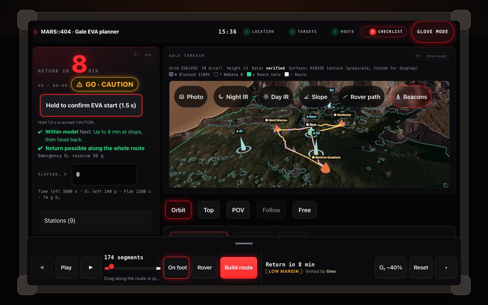
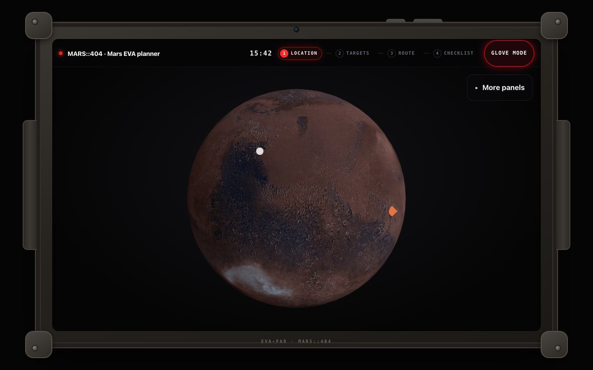
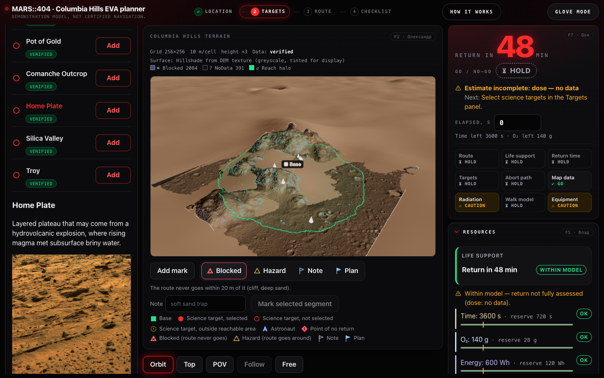

# MARS//404 — know when to turn back

**An offline tablet planner for walking EVAs on Mars, built on real NASA terrain.**

NASA Space Apps Challenge 2026 · Challenge: **Interplanetary Survival Guide: Martian Map** · Team: **MARS//404**

| | |
|---|---|
| **Live app** | https://xand0dev.github.io/mars404/ (no login, no API keys, works offline once loaded) |
| **Source code** | this repository, Apache-2.0 |
| **Demo video** | _to be added_ |

> MARS//404 is a demonstration model, not certified navigation. The best status the app ever shows is **"within model"**, never "safe".



---

## Overview

MARS//404 is a map and HUD for an astronaut walking out from a base on Mars. Pick a site on a 3D Mars globe and choose science targets taken from real rover stops. The app then plans a walking loop on high-resolution NASA terrain and keeps counting how long you can stay out before you must head back.

It answers three questions:

1. **Where should I go for science?** Real Curiosity and Spirit stops, each with a surface photo, a short "why go" and credit.
2. **How do I get there safely?** An A\* route over HiRISE terrain that avoids steep slopes and ground with no data.
3. **When do I have to turn back?** A budget for oxygen, energy, time and radiation dose with a reserve, shown as **"Return in N min"**, a reachable-area halo and a **point of no return**.

## The Problem

An astronaut walking on Mars has no GPS. Help from Earth is minutes away, so nobody can react live. The same oxygen, suit battery and time have to cover the walk out and the walk back. A route that looks short on an orbital map can cross slopes that are too steep to walk, or ground that has never been mapped. A plan that worked at the start of the walk can stop working when a resource runs low.

The crew needs a map that shows not just where to go but **whether they can still come home**, and that tells them what to change when the answer is no.

## Our Solution

MARS//404 turns real orbital data into one walking plan with a single question on top: *return in how many minutes?*

- The terrain, imagery and rover stops come from NASA datasets. They are prepared offline, so the app needs no network during the demo.
- Route, reachable area, "Return in N min" and point of no return all come from one calculation core. The numbers in the HUD, on the map and in the checklist always agree.
- When the plan stops working (for example, oxygen drops by 40%), the app says so right away and suggests a closer target.
- Every model number shows its source or the label **"assumption"**, so the crew can see how far to trust it.

## Key Features

| Feature | Why it matters |
|---|---|
| **3D Mars globe and site selection** | Two detailed walking sites: Gale crater / Mount Sharp (Curiosity) and the Columbia Hills, Gusev (Spirit). Olympus Mons and Valles Marineris are terrain overviews without route planning. |
| **Map layers with source and resolution** | Optical (HiRISE), Thermal IR day and night (THEMIS) and a derived slope layer. Each layer shows where it comes from and how detailed it is. |
| **Science targets** | Real rover stops with surface photos, a "why go" note and credit, so the crew picks stops for a reason. |
| **Walking route (A\*)** | A loop from base through the chosen targets and back. It avoids cells steeper than 25° and cells with no data, and shows an elevation profile and segments. |
| **"View from here"** | Shows the nearest real Navcam surface photo to a selected route segment. |
| **Return in N min, reachable halo, point of no return** | Oxygen, energy and time with a fixed reserve. Segments with no safe return turn red. |
| **GO / NO-GO checklist** | Covers route, life support, return time, targets, abort path, map data, radiation, walk model and equipment before the walk starts. |
| **"What if → O₂ −40%"** | Shows right away whether the plan still brings you home. If not, the app proposes a closer target. |
| **Walk preview** | An astronaut walks the planned route over the terrain (Follow camera, 1×–60×) with elapsed time, O₂ and energy. |
| **On foot vs Rover** | Compares time, O₂, "Return in" and battery for the same plan. In Rover mode a Curiosity 3D model drives the route. |
| **Navigation without GPS** | Line-of-sight beacons plus inertial position with drift. Shows how much of the route has a precise position. |
| **Crew map notes** | Blocked / Hazard / Note / Plan marks that change the route, with JSON export and import. |
| **Field-ready UI** | Glove mode with large controls, a rugged tablet frame, full keyboard control, a 400 px phone layout, reduced motion and a 2D fallback (`?2d`). |

## How It Works

Button names are as they appear on screen.

1. Open the app. On the 3D globe, choose **Gale / Mount Sharp** (mouse, Tab + Enter or Space). The globe flies to the site and opens the 3D terrain.
2. In **Layers**, switch between Optical (HiRISE), Thermal IR night (THEMIS) and Slope (derived).
3. Open **Targets**, then **Mont Mercou**, to see the Curiosity photo, "why go" and credit. Add **Brantôme** and **Mont Mercou**, then press **Build route**.
4. The HUD shows **Return in N min** and a **GO / NO-GO** verdict. Select a segment and press **View from here** to see the nearest real Navcam image.
5. Press **What if → O₂ −40%**. The reachable halo shrinks, segments without a return turn red, and **Point of no return in N min** appears. With Nontron Quadrant + Mont Mercou + Gardonne selected, the plan becomes NO-GO and the app suggests **Replace Nontron Quadrant with Brantôme**.
6. Press **▶ Walk the route** to watch the astronaut walk the plan. Switch to **Rover** to compare the same plan on a rover.
7. Press **Back to globe**, then **Columbia Hills (Gusev)**, to plan a second site along Spirit's traverse.

## Screenshots

| Site selection on the 3D globe | Science target with a real rover photo |
|---|---|
|  |  |

These screenshots were taken during development. Some numbers and labels in them may differ from the current build. Please use the [live app](https://xand0dev.github.io/mars404/) as the reference.

## Technology Stack

- **Frontend:** React 19, TypeScript (strict), Vite
- **3D:** three.js, React Three Fiber, drei
- **State:** Zustand (one mission store)
- **Routing:** A\* in a Web Worker
- **Testing:** Vitest + Testing Library (unit), Playwright (end-to-end), ESLint
- **Data pipeline:** Python in Docker (`pipeline/`), run once, offline
- **Hosting:** a static site on GitHub Pages with no backend

## Installation and Usage

**Requirements:** Node.js 22.22+, 24.15+ or 26+ (CI uses Node 24, see `.nvmrc`) and npm.

```bash
git clone https://github.com/xand0dev/mars404.git
cd mars404
npm ci

npm run dev                        # development server
npm run build && npm run preview   # production build; works without network
npm run check                      # lint + typecheck + unit tests + build
npm run e2e                        # Playwright end-to-end tests
```

All map data is already in `public/data/`, so you don't need to run the pipeline to use the app. To rebuild the data from NASA sources, see [`pipeline/README.md`](pipeline/README.md).

## Project Architecture

```text
NASA Mars Trek, MMGIS, raw images, PDS
        │  once, offline
        ▼
pipeline/   crop → resample → slope / traversability / hazard → validate → sha256
        ▼
public/data/<site>/   terrain, layers, targets, photos, traverse
        ▼
useMission (single store) ◄─ globe · layers · targets · A* route (Web Worker) · budget & return · HUD
        ▼
3D terrain / 2D plan
```

| Path | Purpose |
|---|---|
| `src/core/` | Shared calculations: resource budget, "Return in N min", reachable area, point of no return |
| `src/features/` | Product features: `globe`, `terrain`, `data` (layers), `science`, `route`, `budget`, `hud`, `notes`, `prep` |
| `src/store/` | The single mission store |
| `src/contracts/` | Shared types between features |
| `pipeline/` | Reproducible offline data preparation |
| `public/data/` | Prepared terrain, layers, targets and photos |
| `e2e/` | Playwright end-to-end tests |

The terrain grid is 256 × 256 cells of 10 m (2.56 × 2.56 km). The route cost is modelled walking time, based on slope, soil and hazard.

Product specification: [`docs/SPEC.md`](docs/SPEC.md) (in Ukrainian).

## NASA Resources and Data Sources

All data is cropped and resampled offline by a reproducible pipeline and stored in `public/data/`. Each layer in the app shows its source and resolution.

| Data | Source | Used for |
|---|---|---|
| Gale and Columbia Hills terrain, 1 m | MRO HiRISE stereo DEMs, NASA Mars Trek | Walking grid, slope, route, 3D terrain |
| Curiosity area orthomosaic | HiRISE, NASA Mars Trek | Optical layer, terrain texture |
| Thermal IR day / night, 100 m | THEMIS IR, Mars Odyssey (NASA/JPL-Caltech/ASU) | Thermal layers, soil slowdown estimate |
| Terrain around the sites, Olympus Mons, Valles Marineris, 200 m | MOLA + HRSC blended DEM (NASA/GSFC, ESA/DLR/FU Berlin, USGS) | Surrounding terrain and overview sites |
| Globe texture | Viking MDIM 2.1 colorized mosaic (USGS Astrogeology); colour is artistic | 3D globe |
| Site centres | IAU Gazetteer of Planetary Nomenclature (USGS) | Globe markers |
| Rover traverses and stops | MSL MMGIS (Curiosity), Spirit layers in Mars Trek | Science targets, rover path layer |
| Target photos and "View from here" | Curiosity Navcam raw images, Spirit Navcam (PDS Imaging Node), Spirit Pancam (Photojournal) | Target cards, segment photos |
| Curiosity 3D model | NASA 3D Resources (public domain) | Rover mode |

The full list with product IDs, dates, licences and credits is in [`docs/SOURCES.md`](docs/SOURCES.md).

**Model limits.** The model has no real-time telemetry, weather or dust storms. Details smaller than 10 m are not resolved. NoData cells are always blocked, never treated as safe. Walking speed and O₂ use come from Apollo data (the Moon, 1/6 g) and are labelled **assumption** for Mars. Three values are backed by a source: 30 min emergency O₂ (EMU Secondary Oxygen Package), the 922 Wh suit battery (NASA EMU) and a surface dose of 0.67 mSv/day (Curiosity RAD, Gale). The full list of assumptions is in [`specs/F5/assumptions-en.md`](specs/F5/assumptions-en.md).

## Challenge Alignment

The challenge asks for a Martian map that works as a survival guide. MARS//404 handles this as a map for one specific, risky job: a walk away from the base.

- **A Martian map built on real data.** HiRISE 1 m terrain, THEMIS thermal and MOLA + HRSC elevation, with no made-up terrain. Every layer shows its source and resolution.
- **Survival first.** The main output is not distance but **"Return in N min"**. It comes with a reserve, a point of no return and a GO / NO-GO verdict before the walk.
- **Guidance when things go wrong.** The O₂ −40% scenario shows how the plan breaks and proposes a fix, such as a closer target.
- **Designed for the field.** It works offline, finds position without GPS (beacons + inertial drift), and supports glove mode, crew hazard notes and a tablet form factor.
- **Honest about limits.** Every number carries a source or the "assumption" label, and the app never claims "safe".

## Team

| Name | GitHub | Role |
|---|---|---|
| Oleksandr | [@xand0dev](https://github.com/xand0dev) | Scaffold, integration, 3D terrain, video, submission |
| Olia | [@oljyaaa](https://github.com/oljyaaa) | UI, HUD, design system, demo script, slides |
| Ivan | [@gonivanko](https://github.com/gonivanko) | 3D globe, site selection, crew map notes |
| Maksym | [@kingsneverdie17](https://github.com/kingsneverdie17) | Data pipeline, layers, NASA data |
| Vlad | [@froozy3](https://github.com/froozy3) | A\* route, resource and return model |
| Nastia | [@Bulka0801](https://github.com/Bulka0801) | Science targets and photos, QA, sources |

## Use of AI

Code, tests and documentation were written by AI coding agents (mostly Claude Code, also Codex) from specifications written by people. People chose the challenge, wrote the specs and acceptance criteria, checked every change in the browser and on CI, and decided what to merge. Each AI session is logged in [`docs/AI_LOG.md`](docs/AI_LOG.md). No AI-generated data, images or numbers are presented as NASA data.

## Future Improvements

None of the following is in the current build:

- More walking sites beyond Gale and Columbia Hills.
- Weather and dust-storm inputs, and a terrain-aware radiation model instead of a single point measurement.
- Verified Mars-specific walking and O₂ coefficients to replace the Apollo-based assumptions.

## License

Code: Apache-2.0, see [`LICENSE`](LICENSE). Data is under the licences of its sources, listed in [`docs/SOURCES.md`](docs/SOURCES.md).
